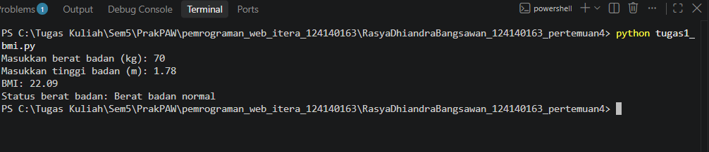
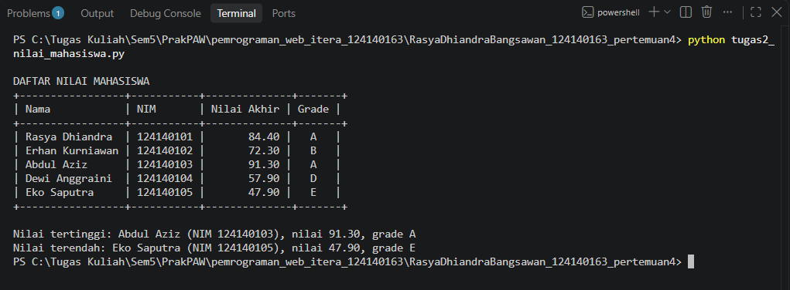
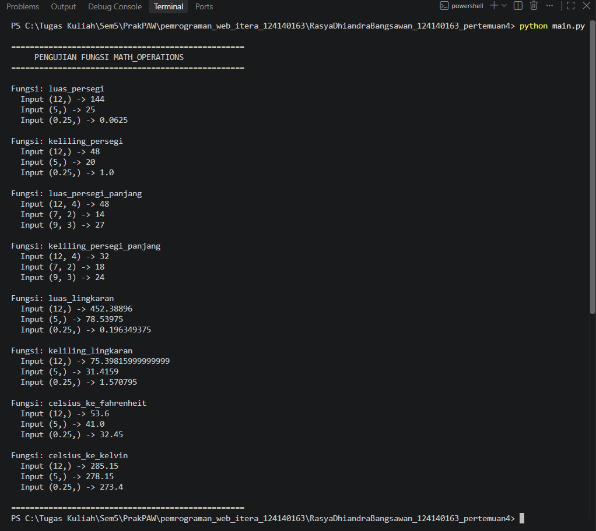

# Tugas Pertemuan 4

## Identitas Mahasiswa
- **Nama:** Rasya Dhiandra Bangsawan
- **NIM:** 124140163

## Alur Kerja dan Fungsi Program
Setiap program dijalankan secara terpisah dari terminal. Program menerima masukan yang diperlukan, memprosesnya sesuai instruksi soal, lalu menampilkan hasil ke terminal.

| Program | Fungsi |
|---|---|
| Soal 1 (`tugas1_bmi.py`) | Menghitung Body Mass Index (BMI) dari berat badan (kg) dan tinggi badan (m) yang disimpan dalam variabel atau dimasukkan melalui `input()`. Program menghitung BMI dengan rumus `berat / (tinggi * tinggi)`, lalu menggunakan percabangan `if-elif-else` untuk menentukan kategori: berat badan kurang (< 18.5), normal (18.5 – < 25), berlebih (25 – < 30), atau obesitas (≥ 30). Nilai BMI ditampilkan dengan 2 angka desimal menggunakan f-string beserta kategori status berat badannya di konsol. |
| Soal 2 (`tugas2_nilai_mahasiswa.py`) | Mengelola data nilai mahasiswa yang disimpan dalam list berisi minimal 5 dictionary (kunci: `nama`, `nim`, `nilai_uts`, `nilai_uas`, `nilai_tugas`). Program menghitung nilai akhir setiap mahasiswa dengan bobot UTS 30%, UAS 40%, dan Tugas 30%, lalu menentukan grade A–E berdasarkan rentang nilai akhir. Seluruh data (Nama, NIM, Nilai Akhir, Grade) ditampilkan dalam tabel yang rapi di terminal menggunakan perataan f-string, kemudian program mencari dan menampilkan mahasiswa dengan nilai akhir tertinggi dan terendah. |
| Soal 3 (`math_operations.py` dan `main.py`) | `math_operations.py` adalah modul berisi konstanta `PI`, fungsi luas dan keliling untuk persegi, persegi panjang, dan lingkaran, serta fungsi konversi suhu dari Celsius ke Fahrenheit dan Celsius ke Kelvin. `main.py` adalah program utama yang mengimpor modul tersebut dengan dua cara berbeda (`import math_operations` dan `from math_operations import ...`), memanggil seluruh fungsinya dengan berbagai nilai uji, dan menampilkan hasil kalkulasi di konsol dalam format yang rapi dan terstruktur. Program dijalankan melalui `main.py`. |

## Cara Menjalankan
Buka terminal, pindah ke direktori tugas, lalu jalankan skrip yang diinginkan. Pastikan Python sudah terpasang. Jika nama berkas di folder berbeda, ganti nama berkas pada perintah berikut.

```bash
cd "RasyaDhiandraBangsawan_124140163_pertemuan4"
python tugas1_bmi.py
python tugas2_nilai_mahasiswa.py
python main.py
```

## Bukti Eksekusi di Terminal

### Soal 1


### Soal 2


### Soal 3

