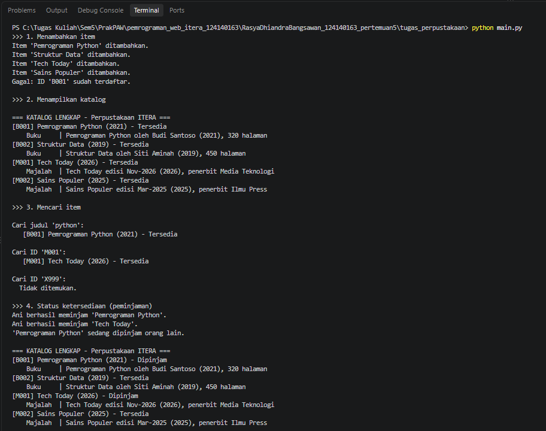
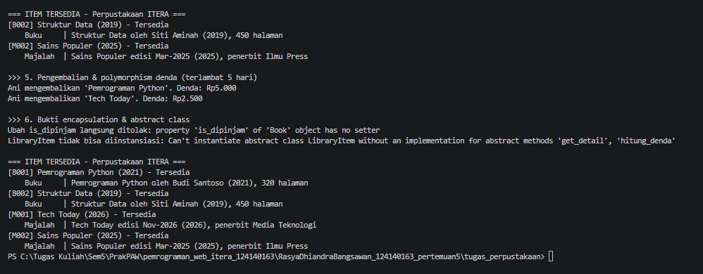

# Tugas Pertemuan 5 - Sistem Manajemen Perpustakaan Sederhana

## Identitas Mahasiswa
- **Nama Lengkap** : Rasya Dhiandra Bangsawan
- **NIM**          : 124140163
- **Kelas Praktikum** : RA

## Deskripsi Program
Program ini adalah sistem manajemen perpustakaan sederhana berbasis OOP Python.
Alur program: `main.py` membuat object `Library`, menambahkan beberapa `Book` dan
`Magazine`, menampilkan katalog, mencari item berdasarkan judul/ID, lalu
mendemonstrasikan status ketersediaan lewat peminjaman dan pengembalian oleh `Member`.

### Penerapan 4 Pilar OOP
| Pilar | Penerapan |
|-------|-----------|
| **Class** | `LibraryItem`, `Book`, `Magazine`, `Library`, dan `Member` memodelkan entitas perpustakaan beserta atribut dan perilakunya. |
| **Inheritance** | `Book` dan `Magazine` mewarisi `LibraryItem` (abstract class) dan memakai `super().__init__()`. Setiap subclass mengimplementasikan abstract method `hitung_denda()` dan `get_detail()`. |
| **Encapsulation** | Atribut `_item_id`, `_title` bersifat *protected*; `__is_dipinjam` (di `LibraryItem`) dan `__koleksi` (di `Library`) bersifat *private*. Akses melalui `@property` (mis. `is_dipinjam` tanpa setter) dan method `pinjam()`/`kembalikan()`. |
| **Polymorphism** | `hitung_denda()` dan `get_detail()` dipanggil dengan cara sama pada semua `LibraryItem`, tetapi hasilnya berbeda (denda buku Rp1.000/hari, majalah Rp500/hari). |

## Struktur Folder
```
tugas_perpustakaan/
├── library_item.py   # LibraryItem (ABC), Book, Magazine
├── member.py         # Member
├── library.py        # Library
└── main.py           # Program utama / demo
```

## Screenshot Output
Fitur penambahan, pencarian, dan penampilan katalog:



